# Linux Privilege Escalation

## Task 1 - Introduction

Privilege escalation is a journey and it quite depends on the specific configuration of the target system. The kernel version, installed applications, supported programming languages, other users' passwords are a few key elements that will affect your road to the root shell.

## Task 2 - What Is Privilege Escalation ?

#### What does "privilege escalation" mean?

Privilege Escalation simply means going from a lower permission account to a higher one.

In technical terms, it is an exploitation of a vulnerability or flaw in an Operating system or an application to gain unauthroized access.

#### Why is it important?

Privilege escalation is crucial because it lets you gain system administrator levels of access, which allows you to perform actions such as:

- Resetting passwords
- Bypassing access controls to compromise protected data
- Editing software configurations
- Enabling persistence
- Changing the privilege of existing (or new) users
- Execute any administrative command

## Task 3 - Enumeration

Enumeration is the first step you have to take once you gain access to any system. You may have accessed the system by exploiting a critical vulnerability that resulted in root-level access or just found a way to send commands using a low privileged account.

#### Logging In With SSH:

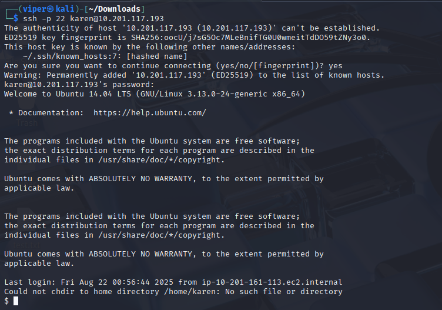

### hostname

Returns the hostname of the target machine

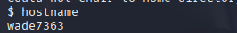

### uname -a

Prints system information giving us additional detail about the kernel used by the system. This will be useful when searching for any potential kernel vulnerabilities that could lead to privilege escalation.

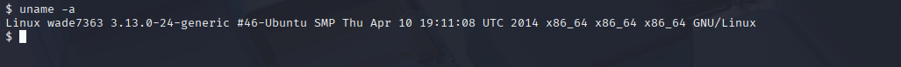

### /proc/version

The proc filesystem (procfs) provides information about the target system processes. 

Looking at `/proc/version` may give you information on the kernel version and additional data such as whether a compiler (e.g. GCC) is installed.

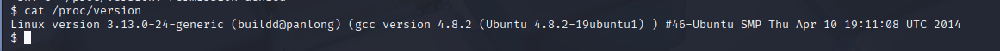

### /etc/issue

Systems can also be identified by looking at the /etc/issue file. This file usually contains some information about the operating system but can easily be customized or changed.

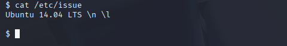

### ps Command

To see running processes on a Linux system. Typing `ps` on your terminal will show processes for the current shell.

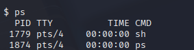

The output shows the following:

- PID (process id unique to the process)
- TTY (Terminal type used by user)
- Time (Amount of CPU time used by the process)
- CMD (Command or executable running)

#### Useful Options

The “ps” command provides a few useful options.

- `ps -A`:

    View all running processes

    

- `ps axjf`: 

    View process tree 

    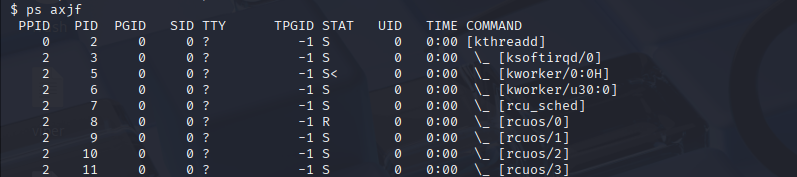

- `ps aux`: 

    The aux option will show:
    
    - Processes for all users (a)
    - Display the user that launched the process (u)
    - Show processes that are not attached to a terminal (x)
    
        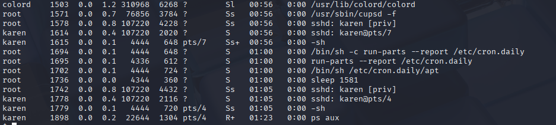
    
    Looking at the ps aux command output, we can have a better understanding of the system and potential vulnerabilities.

### env 

Shows environment variables

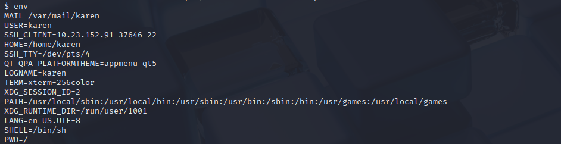

### sudo -l

The target system may be configured to allow users to run some (or all) commands with root privileges. The `sudo -l` command can be used to list all commands your user can run using sudo.

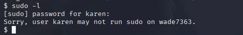

### ls

One of the common commands used in Linux is probably ls.

While looking for potential privilege escalation vectors, the ls command with the -la parameter comes handy.

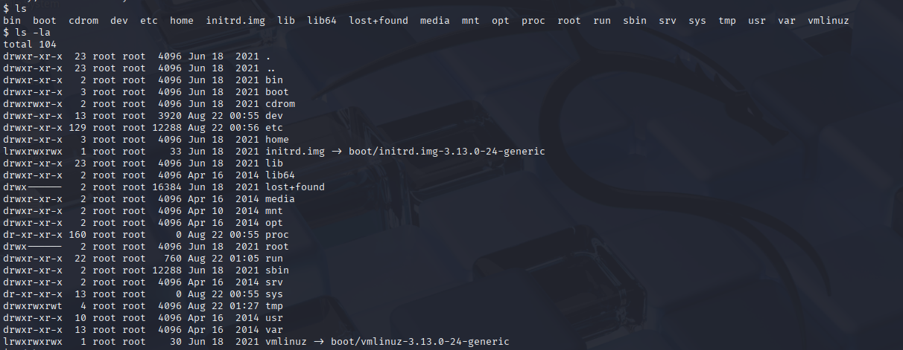

### Id

The id command will provide a general overview of the user’s privilege level and group memberships.

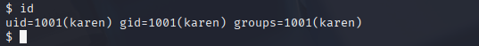

### /etc/passwd

Reading the /etc/passwd file can be an easy way to discover users on the system.

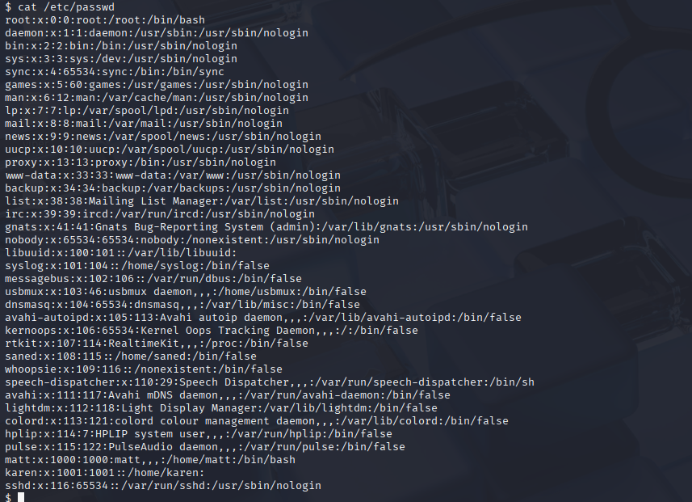

While the output can be long and a bit intimidating, it can easily be cut and converted to a useful list for brute-force attacks.

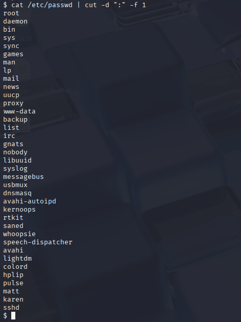

Remember that this will return all users, some of which are system or service users that would not be very useful. Another approach could be to grep for “home” as real users will most likely have their folders under the “home” directory.

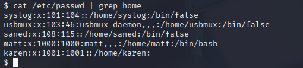

### history

Looking at earlier commands with the history command can give us some idea about the target system and, albeit rarely, have stored information such as passwords or usernames.

### ifconfig

The ifconfig command will give us information about the network interfaces of the system. It is important as the target machine may act as a pivoting point for other networks.

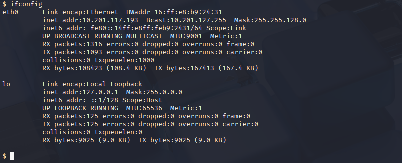

### ip route command

The ip route command can help us confirm which networks in ifconfig are reachable to us.

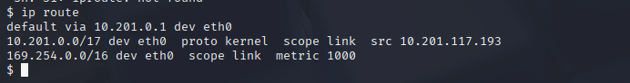

### netstat

The netstat command can be used with several different options to gather information on existing connections.

- `netstat -a` shows all listening ports and established connections
- `netstat -at` or `netstat -au` can be used to list TCP or UDP protocols respectively
- `netstat -l` lists ports in listening mode 
- `netstat -s` list network usgae statistics by protocol 
- `netstat -tp` list connections with service name and PID information
- `netstat -i` shows interface statistics
- `netstat -ano` -> `-a` to display all sockets, `-n` to resolve names, `-o` display timers

    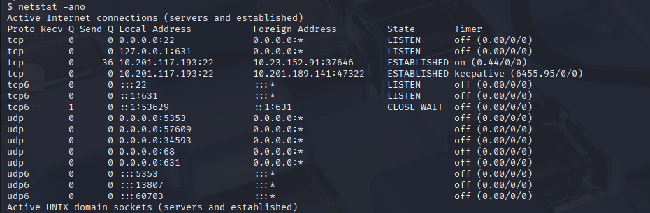

### find Command

Searches the target system for important information and potential privilege escalation.

#### Basic Syntax

`find <file-name>`

#### Find files:

- `find . -name flag1.txt`: find the file named “flag1.txt” in the current directory
- `find /home -name flag1.txt`: find the file names “flag1.txt” in the /home directory
- `find / -type d -name config`: find the directory named config under “/”
- `find / -type f -perm 0777`: find files with the 777 permissions (files readable, writable, and executable by all users)
- `find / -perm a=x`: find executable files
- `find /home -user frank`: find all files for user “frank” under “/home”
- `find / -mtime 10`: find files that were modified in the last 10 days
- `find / -atime 10`: find files that were accessed in the last 10 day
- `find / -cmin -60`: find files changed within the last hour (60 minutes)
- `find / -amin -60`: find files accesses within the last hour (60 minutes)
- `find / -size 50M`: find files with a 50 MB size

#### Folders and Files With Write and Execute Permissions:

- `find / -writable -type d 2>/dev/null` : Find world-writeable folders
- `find / -perm -222 -type d 2>/dev/null`: Find world-writeable folders
- `find / -perm -o w -type d 2>/dev/null`: Find world-writeable folders
- `find / -perm -o x -type d 2>/dev/null` : Find world-executable folders

#### Find Development Tools and Supported Languages:

- `find / -name perl*`
- `find / -name python*`
- `find / -name gcc*`

#### Find Specific File Permissions:

- `find / -perm -u=s -type f 2>/dev/null`: Find files with the SUID bit, which allows us to run the file with a higher privilege level than the current user.

---

### Answer the questions below

- What is the hostname of the target system?

    `wade7363`

    

- What is the Linux kernel version of the target system?

    `3.13.0-24-generic`

    

- What Linux is this?

    `Ubuntu 14.04 LTS`

    

- What version of the Python language is installed on the system?

    `2.7.6`

    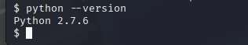

- What vulnerability seem to affect the kernel of the target system? (Enter a CVE number)

    `CVE-2015-1328`

    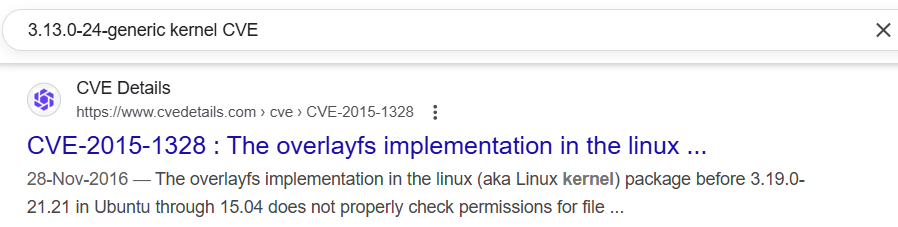

---

## Task 4 - Automated Enumeration Tools

Several tools can help us save time during the enumeration process. These tools should only be used to save time knowing they may miss some privilege escalation vectors. Below is a list of popular Linux enumeration tools with links to their respective Github repositories:

The target system’s environment will influence the tool you will be able to use. For example, we will not be able to run a tool written in Python if it is not installed on the target system. This is why it would be better to be familiar with a few rather than having a single go-to tool.

- LinPeas: https://github.com/carlospolop/privilege-escalation-awesome-scripts-suite/tree/master/linPEAS
- LinEnum: https://github.com/rebootuser/LinEnum
- LES (Linux Exploit Suggester): https://github.com/mzet-/linux-exploit-suggester
- Linux Smart Enumeration: https://github.com/diego-treitos/linux-smart-enumeration
- Linux Priv Checker: https://github.com/linted/linuxprivchecker

---

## Task 5 - Privilege Escalation : Kernel Exploits

The kernel on Linux systems manages the communication between components such as the memory on the system and applications. This critical function requires the kernel to have specific privileges; thus, a successful exploit will potentially lead to root privileges.

The Kernel exploit methodology is simple;

- Identify the kernel version
- Search and find an exploit code for the kernel version of the target system
- Run the exploit

> Although looks simple but its important to remember that a failed kernel exploit can lead to a system crash

